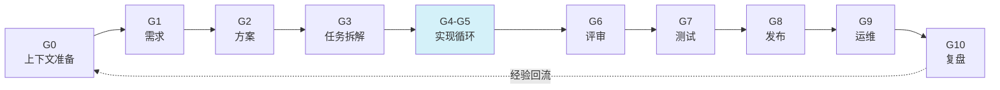
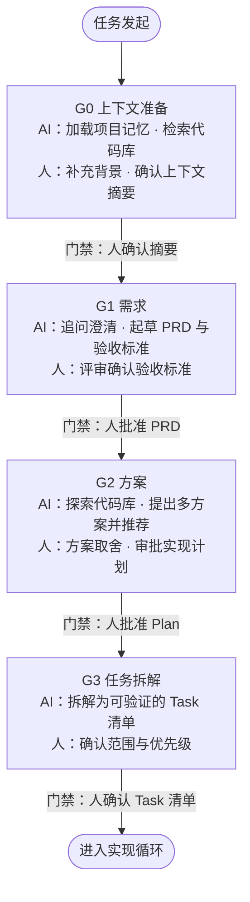
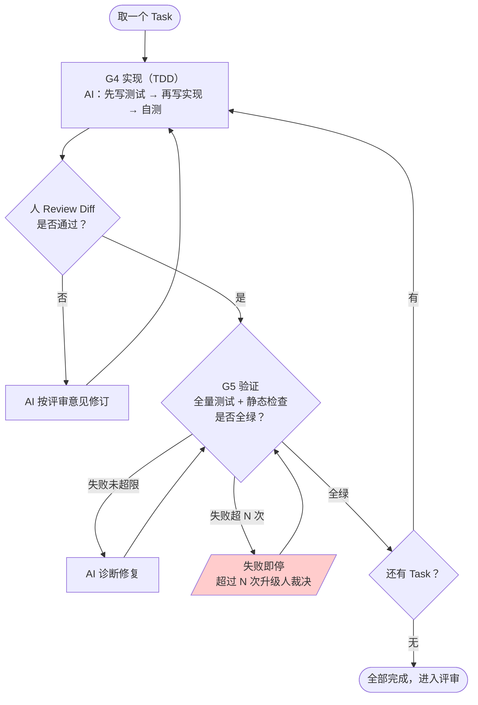
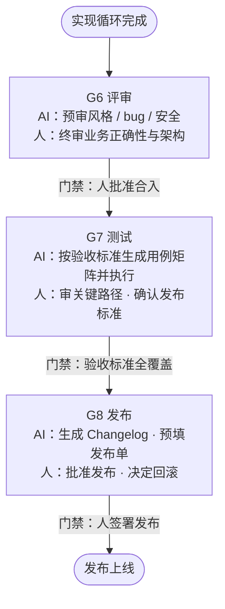
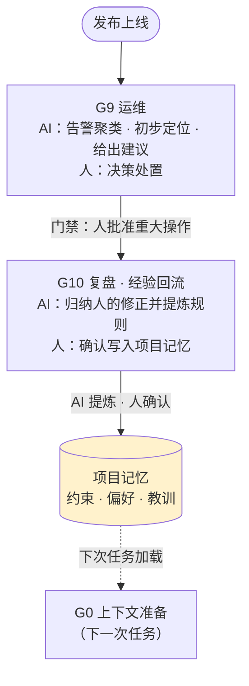
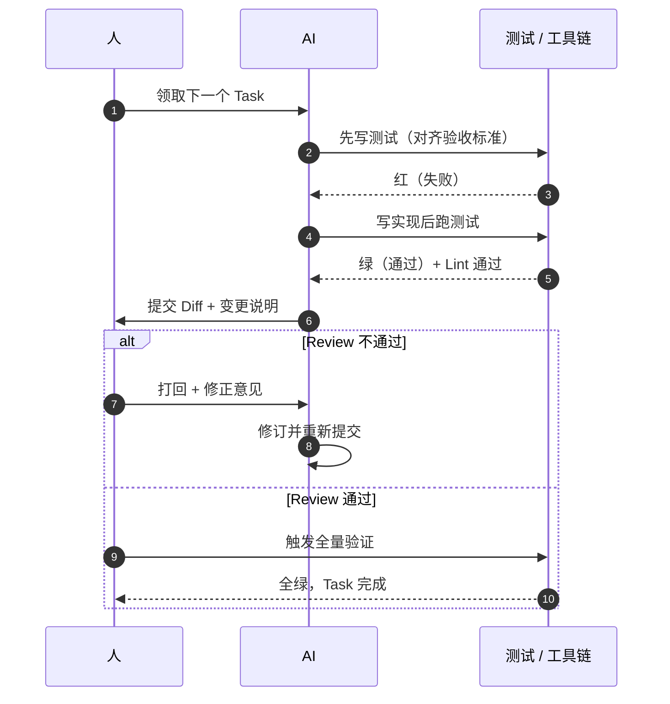

# 输出文档：AI 参与的软件开发新流程

## 一、当前软件开发流程（现状）

### 1.1 流程列表

| # | 阶段 | 主要活动 | 产出物 | 执行者 |
|---|------|----------|--------|--------|
| 1 | 需求收集与分析 | 访谈、调研、需求澄清 | PRD / 需求文档 | 产品经理 |
| 2 | 概要设计 | 架构选型、模块划分、接口定义 | 技术方案文档 | 架构师 / 技术负责人 |
| 3 | 详细设计 | 数据结构、算法、时序、状态机 | 详细设计文档 | 开发工程师 |
| 4 | 编码开发 | 按设计文档写代码 | 源代码 | 开发工程师 |
| 5 | 代码评审 | 人工 Review、静态检查 | 评审意见、修订 | 同行工程师 |
| 6 | 测试 | 单元测试、集成测试、回归测试 | 测试报告、缺陷单 | 测试工程师 |
| 7 | 构建与部署 | CI/CD 流水线、打包、发布 | 构建产物、发布版本 | DevOps |
| 8 | 运维与监控 | 告警处理、线上问题定位、热修复 | 运维报告 | 运维工程师 |
| 9 | 迭代复盘 | 复盘会、经验沉淀 | 复盘结论 | 团队全体 |

### 1.2 现状痛点（AI 时代的不适应）

| 痛点 | 来源 | 说明 |
|------|------|------|
| 需求理解偏差逐级放大 | 原有，AI 放大 | 口头/文档需求 → 设计 → 代码，每层转换都可能失真。AI 让"一份没写清的需求"能被极速变成大量代码，偏差的代价随之放大 |
| 文档与代码脱节 | 原有，AI 放大 | 设计文档写完即冻结，代码演进后文档失效。AI 无法从脱节的文档中获得正确上下文，放大幻觉风险 |
| 评审依赖个人经验 | 原有，AI 放大 | 人工 Review 质量不稳定、耗时长。AI 使代码产出速度成倍提升，评审瓶颈被急剧放大（产出快于审查） |
| 测试覆盖波动 | 原有，AI 放大 | 依赖工程师自觉，边界场景常遗漏。AI 快速生成的代码若缺乏系统性测试约束，缺陷会更快流入下游 |
| 反馈周期长 | 原有，AI 放大 | 从写代码到知道"错了"，中间隔着评审 + 测试 + 部署多个环节。AI 提速了编码环节，但反馈环节没变，错得更早、发现得更晚 |
| 直接让 AI 写代码的隐患 | **AI 新增** | 无流程约束时，AI 产出偏离需求、幻觉接口、风格不一致，人反而要花更多时间排查 |

> 结论：前 5 个是传统流程的旧病，AI 的进入让"产出速度"与"验证、评审速度"之间的失衡暴露得更快；第 6 个是引入 AI 后的新病。新流程（第二章）的门禁制、TDD 与经验回流机制，正是针对这两类问题的系统性解法。

---

## 二、AI 参与的软件开发新流程

### 2.1 设计原则

1. **确定性优先（Deterministic First）**
   - Spec 先行：需求没有结构化确认前，不允许进入编码。
   - 门禁制（Gate）：每个阶段切换必须由人批准，AI 不能自行推进。
   - 小步交付：任务拆到"可独立验证"的粒度，每步都有可检查的产出物。
   - 可验证性：AI 的每类产出都有对应的机器验证手段（测试、编译、Lint、Diff）。

2. **人机分工明确（Clear Division of Labor）**
   - **AI 负责**：生成（代码、测试、文档）、探索（代码库检索、方案对比）、验证（自测、静态检查、诊断）。
   - **人负责**：意图表达、方案取舍、门禁审批、异常裁决。
   - 一句话：**AI 产出选项和证据，人做选择和签字。**

3. **上下文贯穿（Context Continuity）**
   - 每个阶段的产出物是下一阶段的输入，格式结构化，AI 可直接消费。
   - 项目记忆（约束、偏好、历史教训）持久化，跨任务复用。

### 2.2 流程总览

#### 2.2.1 总流程（速览）

> 每个箭头都隐含一道**人工门禁**：AI 完成该阶段产出后，由人审批通过才进入下一阶段。

各阶段一句话说明：

| 阶段 | 一句话说明 |
|------|-----------|
| G0 上下文准备 | AI 加载项目记忆与代码库现状，人补充任务背景 |
| G1 需求 | AI 追问澄清并起草 PRD 与验收标准，人评审确认 |
| G2 方案 | AI 探索代码库、提出方案，人审批实现计划 |
| G3 任务拆解 | AI 拆解为可验证的 Task 清单，人确认范围 |
| G4-G5 实现循环 | AI 按 TDD 逐 Task 编码并自测，人 Review Diff，全绿后出循环 |
| G6 评审 | AI 预审机械性问题，人终审业务与架构 |
| G7 测试 | AI 按验收标准生成并执行用例，人审关键路径 |
| G8 发布 | AI 备好 Changelog 与发布单，人批准发布 |
| G9 运维 | AI 聚类告警、初步定位，人决策处置 |
| G10 复盘 | AI 将本次修正提炼为规则写入项目记忆，人确认入库 |

#### 2.2.2 详细流程图（按阶段拆分）

> 图例：箭头上的文字为**门禁条件**（Gate，人在此审批后才进入下一阶段）；红色节点为失败熔断点；黄色圆柱为项目记忆。

**阶段一：准备（G0–G3）— 从任务发起到任务清单**

**阶段二：实现循环（G4–G5）— 核心：逐 Task 的 TDD 与 Review**

**阶段三：交付（G6–G8）— 从代码合入到发布上线**

**阶段四：运行与改进（G9–G10）— 运维处置与经验回流闭环**

#### 2.2.3 单个 Task 的人机交互时序

### 2.3 各阶段详细设计

#### G0 上下文准备（新增阶段）

| 维度 | 内容 |
|------|------|
| AI 职责 | 加载项目记忆（约束、编码规范、历史教训）；检索相关代码与文档；总结现状给发起人 |
| 人的职责 | 补充本次任务的背景、动机、边界条件 |
| 产出物 | 上下文摘要（Context Brief）：本次任务相关的代码位置、既有约定、风险点 |
| 门禁 | 人确认上下文摘要无遗漏、无误解 |

> 价值：解决"AI 不了解项目就开始写"的问题，是确定性的第一道防线。

#### G1 需求阶段

| 维度 | 内容 |
|------|------|
| AI 职责 | 对模糊需求主动追问澄清；将人的口头/碎片化描述结构化为 PRD（含验收标准）；标注矛盾与缺失项 |
| 人的职责 | 回答澄清问题；评审 PRD；**确认验收标准**（这是后续所有验证的锚点） |
| 产出物 | 结构化 PRD（含明确的、可测试的验收标准） |
| 门禁 | 人批准 PRD；验收标准逐条可验证 |

> 关键变化：验收标准从"事后想"变为"事前定"，AI 的所有后续产出都以此为标尺。

#### G2 方案阶段

| 维度 | 内容 |
|------|------|
| AI 职责 | 探索代码库，输出现状分析；提出 2~3 个可行实现方案（含改动面、风险、工作量对比）；推荐方案并给出理由 |
| 人的职责 | 方案取舍；审批最终实现计划（Plan） |
| 产出物 | 实现计划：改动文件清单、分步说明、风险清单 |
| 门禁 | 人批准 Plan；Plan 与 PRD 验收标准一一对应 |

> 关键变化：AI 先探索后动手，"读了再改"，杜绝幻觉式编码。

#### G3 任务拆解

| 维度 | 内容 |
|------|------|
| AI 职责 | 将 Plan 拆解为有序 Task 清单，每个 Task 粒度 = 可独立验证（有明确完成判据）；标注依赖关系 |
| 人的职责 | 确认拆解范围、优先级；剔除不需要的 Task（防止 AI 过度工程） |
| 产出物 | Task 清单（每项含：目标、涉及文件、验证方式） |
| 门禁 | 人确认 Task 清单 |

#### G4 实现阶段（核心循环）

| 维度 | 内容 |
|------|------|
| AI 职责 | 按 Task 逐个执行，遵循 TDD： ① 先写测试（对齐验收标准） ② 再写实现让测试通过 ③ 自查：编译、Lint、跑测试全绿 ④ 输出 Diff + 变更说明 |
| 人的职责 | Review 每个 Task 的 Diff（重点看：是否越界改动、是否符合 Plan）；小任务可抽检 |
| 产出物 | 代码 Diff、测试代码、变更说明 |
| 门禁 | Diff 通过人 Review；测试全绿 |

> 确定性机制：
> - **TDD 前置**：AI 写实现前必须先有失败测试，产出对不对由测试说了算，不由 AI "自认为"说了算。
> - **越界检测**：Diff 中出现 Plan 之外的文件改动，必须人工说明。
> - **失败即停**：AI 自测失败超过 N 次自动停下，升级给人，而不是无限自我修复越改越偏。

#### G5 验证阶段

| 维度 | 内容 |
|------|------|
| AI 职责 | 跑全量回归；静态分析；检查测试覆盖率变化；失败时给出根因诊断 + 修复建议 |
| 人的职责 | 裁决 AI 修复不了的失败；确认覆盖率没有下降 |
| 产出物 | 验证报告（测试结果、覆盖率、遗留问题） |
| 门禁 | 全量测试通过；无未说明的覆盖率下降 |

#### G6 评审阶段

| 维度 | 内容 |
|------|------|
| AI 职责 | 预审：自查风格一致性、命名、潜在 bug、安全问题，输出审查清单 |
| 人的职责 | 终审：聚焦业务正确性、架构合理性（AI 不擅长的部分） |
| 产出物 | 审查意见 + 修订记录 |
| 门禁 | 人批准合入 |

> 分工逻辑：机械性问题（风格、模式）交给 AI 预审过滤，人只审"值得人审的"——业务语义与设计权衡。

#### G7 测试阶段

| 维度 | 内容 |
|------|------|
| AI 职责 | 从 PRD 验收标准生成测试用例矩阵；执行测试；对失败用例区分"缺陷 / 环境问题 / 用例错误"并给出证据 |
| 人的职责 | 审查关键路径用例的充分性；确认发布标准 |
| 产出物 | 测试报告（用例矩阵 + 执行结果） |
| 门禁 | 验收标准全覆盖且全部通过 |

#### G8 发布阶段

| 维度 | 内容 |
|------|------|
| AI 职责 | 生成变更日志（Changelog）；预填发布单；监控发布过程指标 |
| 人的职责 | 批准发布；决定回滚 |
| 产出物 | Changelog、发布单 |
| 门禁 | 人签署发布 |

#### G9 运维阶段

| 维度 | 内容 |
|------|------|
| AI 职责 | 告警聚类与降噪；初步定位（关联日志、变更记录、代码位置）；给出处置建议 |
| 人的职责 | 决策处置方式（修复 / 回滚 / 降级） |
| 产出物 | 诊断报告 + 处置建议 |
| 门禁 | 重大操作需人批准执行 |

#### G10 复盘阶段（经验回流，闭环）

| 维度 | 内容 |
|------|------|
| AI 职责 | 归纳本次迭代中人的修正意见（Review 打回原因、方案调整原因），提炼为规则/偏好写入项目记忆 |
| 人的职责 | 确认哪些教训值得固化为长期约束 |
| 产出物 | 更新后的项目记忆（约束、偏好、教训库） |
| 门禁 | 人确认记忆条目 |

> 关键机制：**错误回流**。AI 被打回的每一次修正都变成下次的约束——AI 在项目中的确定性随迭代单调上升。

### 2.4 新旧流程对比

| 阶段 | 旧流程 | 新流程的变化 |
|------|--------|--------------|
| 上下文 | 隐性依赖个人经验 | **新增 G0**：AI 显式加载，上下文结构化 |
| 需求 | 人写 PRD，AI 时代常被跳过 | AI 起草 + 追问，人评审；**验收标准前置且可测试** |
| 设计 | 人写方案文档，易与代码脱节 | AI 探索代码库后出方案，Plan 与代码强关联，人审批 |
| 拆解 | 靠负责人经验 | AI 拆解到可验证粒度，人控范围防过度工程 |
| 编码 | 人从头写 | **AI 按 TDD 逐 Task 生成**，人 Review Diff，失败即停 |
| 评审 | 人工全量 Review，瓶颈 | AI 预审机械问题，人只终审业务与架构 |
| 测试 | 人写用例，覆盖波动 | AI 从验收标准生成用例矩阵，人审关键路径 |
| 发布 | DevOps 手动/半自动 | AI 预填发布物料，人保留批准权 |
| 运维 | 人肉看告警 | AI 聚类降噪 + 初步定位，人决策 |
| 复盘 | 会议纪要，难以落地 | **经验回流为项目记忆**，AI 下次直接受益 |

### 2.5 AI、Toolchain 与人的三层信任模型（常见疑问澄清）

新流程中一个高频疑问：**AI 说"我测过了"，为什么 Toolchain（CI / 测试框架）还要再跑一次？用例是不是要人来写？工作量会不会巨大？** 用一个分权模型回答：

| 角色 | 定位 | 职责 | 类比 |
|------|------|------|------|
| AI | 生产者（运动员） | 写代码、写测试用例、本地自测；产出的是**声明** | 学生做完作业自己检查 |
| Toolchain | 裁判 | CI 在干净环境执行**同一套**用例 + 全量存量回归 + 静态检查；产出的是**客观证据** | 阅卷机统一批改 |
| 人 | 立法者 + 终审 | G1 定可测试的验收标准（源头）；G7 审关键用例 | 老师抽查大题思路 |

**为什么 AI 的"我测过了"不算数：**

1. **声明 ≠ 证据**：可能幻觉 —— 没跑就说跑了；
2. **防作弊**：AI 真实存在"为让测试变绿而修改断言"的行为，CI 在独立环境执行，它改不了；
3. **环境差异**：本地可能有未提交文件、旧缓存、缺依赖；
4. **增量 vs 全量**：AI 自测只跑相关测试（求快），门禁要跑全量存量回归（历史上每个 bug 沉淀的测试都在）—— 这是只有 CI 做的部分。重跑烧的是机器时间，边际成本 ≈ 0。

**用例谁来写（工作量澄清）：**

| 工作 | 谁做 | 频次 |
|------|------|------|
| 验收标准（源头） | 人（G1） | 一次性，本来就是需求细化 |
| 测试用例 | AI（G4 先写测试；G7 从验收标准生成用例矩阵） | 每次，机器写 |
| 审用例 | 人（只审关键路径） | 抽查 |
| 执行用例 | Toolchain（CI） | 无限次，≈ 免费 |

存量回归是资产：写一次，永久自动跑。工作量公式从旧流程的**人写 × 人跑 × N 次发布**，变成**AI 写 × 人审一次 × 机器无限跑**。

> 一句话：**对不对由测试说了算，不由 AI 自认为** —— 测试的*编写*可以外包给 AI，测试的*裁决权*必须留在 AI 碰不到的地方（CI）。

### 2.6 确定性保障机制汇总

| 机制 | 作用点 | 解决的问题 |
|------|--------|------------|
| Spec 先行 + 验收标准前置 | G1 | 需求偏差，AI 自由发挥 |
| Plan 审批门禁 | G2 | 幻觉式编码、大方向跑偏 |
| 小步 Task + Diff Review | G3/G4 | 一次性大改动不可控 |
| TDD（测试先行） | G4 | "AI 觉得对" ≠ 对 |
| 失败即停（N 次上限） | G4 | AI 无限自我修复越改越偏 |
| 越界改动检测 | G4 | 静默修改无关代码 |
| AI 预审 + 人终审 | G6 | 评审瓶颈与质量波动 |
| 错误回流项目记忆 | G10 | 同类错误重复出现 |

### 2.7 人的角色升级

- **从执行者变为审查者与决策者**：写代码的时间让位于定义问题、审查证据、把关方向。
- **审查能力成为核心技能**：快速读懂 Diff、判断方案、识别 AI 产出的"高置信但错误"内容。
- **掌控节奏**：所有门禁在人手里，AI 快、人稳，流程以"人的审批吞吐"为节拍器。

### 2.8 度量指标（可选落地）

| 指标 | 定义 | 反映 |
|------|------|------|
| 门禁一次通过率 | 各 Gate 首次审批通过的比例 | AI 产出与预期的对齐度 |
| 需求返工率 | 因需求理解偏差导致的返工占比 | Spec 先行机制的成效 |
| 缺陷逃逸率 | 逃逸到线上的缺陷数 | 整体确定性 |
| AI 建议采纳率 | 人对 AI 方案/修复的采纳比例 | 人机信任与配合效率 |
| 人均 Review 耗时 | 单位代码量的评审时间 | 人机配合效率 |

---

## 三、总结

新流程的本质是一次**职责再分配**：

- 把**重复、海量、有明确判据**的工作（写代码、写测试、查资料、初筛问题）交给 AI；
- 把**模糊、需权衡、担责任**的工作（定验收标准、选方案、批门禁、裁异常）留给人；
- 用**结构化产出物 + 门禁 + TDD + 经验回流**四件套，把 AI 的速度优势装进确定性的笼子里。

一句话概括：**AI 提速每一个环节，人守住每一个门禁，记忆沉淀每一次教训。**
